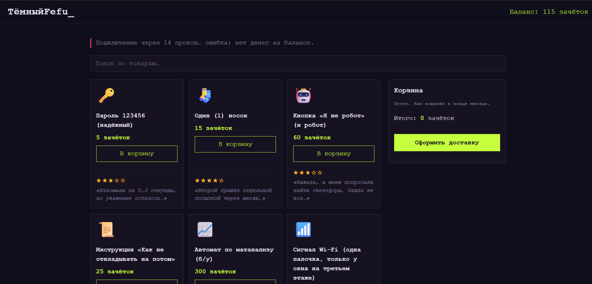

# ТёмныйФефу 

Пародийный «даркнет» для студентов: мемные товары, странные отзывы, своя валюта (зачётки), мини-игры и курьер, который блуждает по корпусу E. Всё вымышлено, любые совпадения случайны.

🔗 **Демо:** https://weqsvert.github.io/temny-fefu/



## Что умеет сайт

- **Каталог товаров** с отзывами, оценками в звёздах и поиском по названию.
- **Корзина и баланс** в зачётках: покупки списывают деньги, при нехватке выдаётся ошибка.
- **Доставка курьером:** анимированный трекер и карта корпуса E, по которой курьер блуждает и ищет выход. Шаги трекера загораются по прогрессу курьера.
- **Мини-игры для пополнения баланса:**
  - «Майнинг зачёток»: кликер с улучшениями и пассивным доходом;
  - «Успей на автобус»: игра на скорость нажатий;
  - казино «Последний автомат»: слот-машина со ставками.
- **Сохранение прогресса:** баланс и улучшения хранятся в `localStorage`, кнопка сброса в подвале.
- Случайные «системные сообщения», глитч-эффект и тёмное оформление в стиле терминала.

## Технологии

HTML, CSS, JavaScript (без библиотек и фреймворков). Для карты используется `<canvas>`, для сохранения `localStorage`, а путь курьера к выходу ищется поиском в ширину.

## Структура проекта

```
├── index.html   # разметка страницы
├── style.css    # оформление и цвета (переменные в :root)
├── script.js    # каталог, корзина, баланс, поиск
├── games.js     # кликер, автобус, казино
├── games.css    # стили мини-игр
├── save.js      # сохранение прогресса в браузере
├── maze.js      # карта корпуса E и анимация курьера
├── maze.css     # стили карты
└── README.md
```

## Запуск локально

1. Скачай или склонируй репозиторий:
   ```bash
   git clone https://github.com/weqsvert/temny-fefu.git
   ```
2. Открой папку в VS Code и запусти `index.html` через расширение Live Server (или просто открой файл в браузере).

## Об авторе

Макарова Ульяна, 2 курс направление «Системное программирование».
Лабораторная работа по веб-разработке.

- Telegram: [@weqsvert//t.me/weqsvert
- Почта: ulikmulik2008@mail.ru

## Примечание

Проект учебный и юмористический. Все товары, отзывы, персонажи и «зачётки» вымышлены и не предназначены ни для чего, кроме веселья.